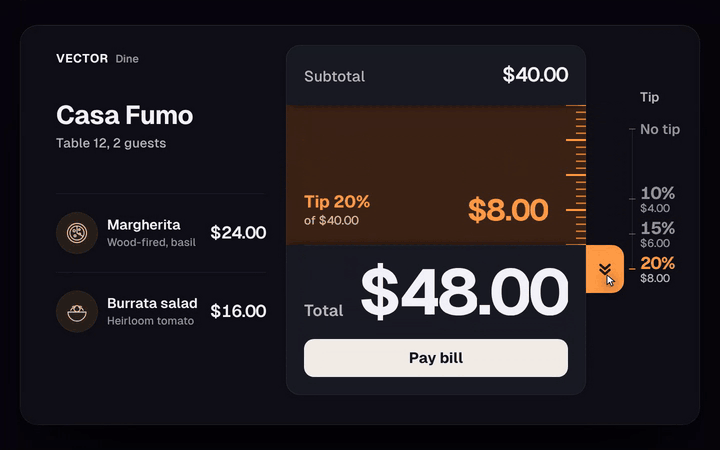

# Receipt Tip

**Pull the bill longer to tip. The tip comes out as a tape, the total rides down with it.**



**Live demo:** [veraetogrex-portfolio.github.io/receipt-tip](https://veraetogrex-portfolio.github.io/receipt-tip/) · **Mockup:** [full-screen version](https://veraetogrex-portfolio.github.io/receipt-tip/mockup/receipt-tip.html)

A restaurant bill with an orange tab on the total. Drag the tab down and the bill gets longer: a tip tape slides out between the subtotal and the total, one tick per percent, and the total moves down with it. Let go and the bill clicks into the nearest stop: No tip, 10, 15 or 20% of the subtotal. On a $40.00 bill, 15% prints "Tip 15% · $6.00" on the tape and the total rolls to $46.00; 20% gives $8.00 and $48.00. Every number follows the bill's length, so the tape, the stop and the total always agree.

## Use it

Three files, no build step, no dependencies, no web fonts:

```
index.html   markup: the order, the bill, the stops
style.css    styles
script.js    drag, stops, rolling digits
```

Download the repo and open `index.html`, or copy the three files into your project.

Paying is left to your app. "Pay bill" fires a `bill:pay` event on `#bill`:

```js
document.querySelector('#bill').addEventListener('bill:pay', e => console.log(e.detail));
// { subtotal: 40, rate: 15, tip: 6, total: 46 }
```

## Try it

- Drag the orange tab down. The tape comes out under the subtotal and the total follows; release and the bill settles on the nearest stop. Pulling past 20% only stretches a little and springs back.
- Click a stop on the right (10%, 15%, 20%) to jump there. Click the chosen stop again, or click "No tip", to push the tape back in.
- Push the tab back up by hand to take the tip off.
- Keyboard: focus the tab, then ↓ / → for the next stop, ↑ / ← for the previous one, Home or Delete for no tip, End for 20%.
- With reduced motion turned on, the bill changes length at once.

## Make it yours

- Dishes and prices: the `.rb-dish` items in `index.html`, `data-price` in dollars. The subtotal is their sum.
- Tip stops: the `.rb-stop` buttons in `index.html`, `data-rate` in percent. Tips count from the subtotal.
- At the top of `script.js`: `PX` is how many pixels the bill grows per percent of tip (14), `TAPE` is the tape length (320), `SEAM` and `TAB` place the stops next to the tab.
- Colours live in `:root` in `style.css`: `--ember` for the tab, the chosen stop and the print on the tape, `--tape` for the tape itself, `--bill` and `--table` for the surfaces.

## What's in `mockup/`

The full 1440×900 screen this component was shot in for the reel:

- `mockup/receipt-tip.html` — interactive. `D` plays the demo, `R` resets.
- `mockup/receipt-tip.autoplay.html` — the scripted loop the reel was recorded from.
- URL flags: `?frame` puts the screen in a browser window, `?clean` hides the control panel, `?once` plays the demo once.

The mockup loads the same `style.css` and `script.js` from the root, plus a shared stage runtime and bundled fonts from `mockup/_shared/`. The component in the root doesn't need any of it.

---

Component 28 of a series. New one every day on Instagram [@veraetogrex_portfolio](https://www.instagram.com/veraetogrex_portfolio/) · all components: [github.com/veraetogrex-portfolio](https://github.com/veraetogrex-portfolio)

MIT licensed.
